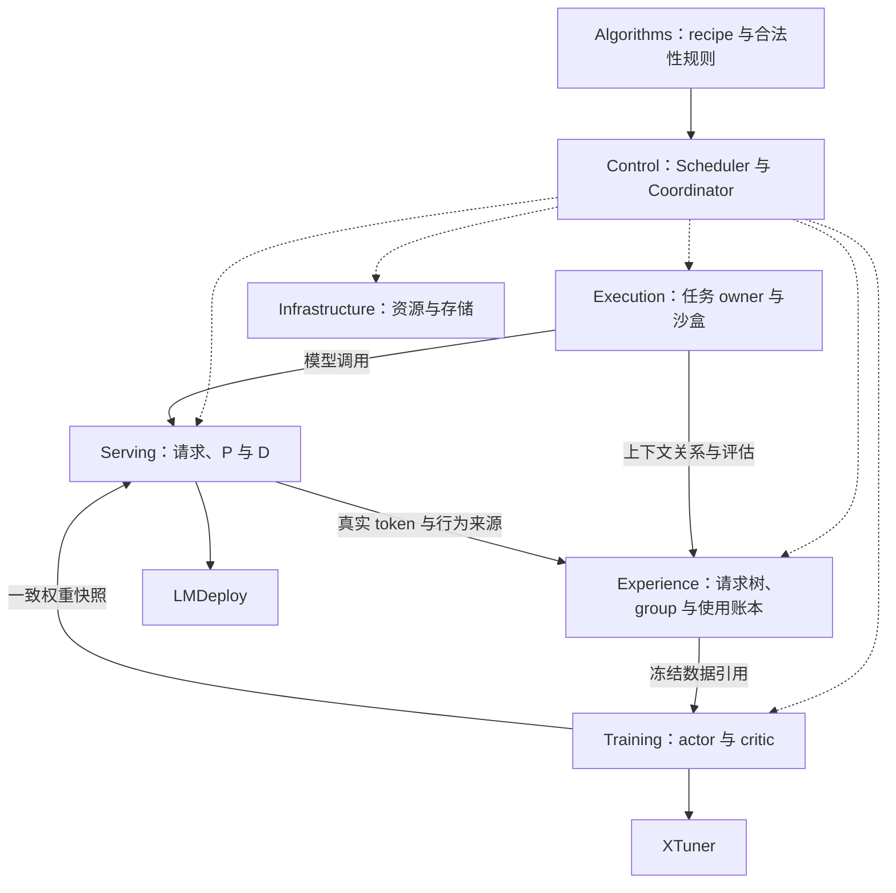

# Odyssey 架构设计

本文描述实现[功能设计](Functional_Design.md)的机制，验收条件只引用 AC 编号。后端已有入口与 pin 事实见[复用清单](Reuse_Map.md)，任务与进度见[实施计划](Plan.md)。

## 1 架构约束

| 原则 | 实施约束 |
| --- | --- |
| 单作业统一控制 | 一个权威 Coordinator；一个 Scheduler 联合选择准入、训练推进、发布和 T/P/D 计划。 |
| 三种生命周期 | execution、训练使用、资源组分别管理；GPU 角色变化不销毁任务和已确认数据。 |
| 闭合批次 | 准入时不绑 batch；训练前冻结成员，反向前冻结目标、mask、权重和分母。 |
| 粗粒度训练协议 | prepare/execute/inspect/snapshot/reconfigure；不公开逐 microbatch 的中心调度协议。 |
| Serving 统一管理 PD | P、D 是独立资源角色；请求、路由、版本和推理状态归同一 Serving 域。 |
| 有限布局转换 | 只实现明确支持的布局与转换边，训练在事务边界重构；稳态布局保留非零 T 和训练请求服务容量。 |
| 薄后端适配 | 直接调用训练/推理引擎，自己维护 RL 外层控制、数据和执行语义。 |
| 复用成熟组件 | 事务存储用集群部署的 PostgreSQL，大文件用 GPFS 或对象存储，进程管理用 Ray；不自建数据库、共识或通用工作流引擎。 |
| 分域单写者 | 各域拥有自己的状态；Control 的观测是投影，不能直接改写其他域状态。 |
| 可恢复协调 | 操作 ID、run_epoch、回执、持久化决策和共同 checkpoint；不假定跨模块天然原子。 |
| 分层通算调优 | XTuner/LMDeploy 实现内部通信与计算重叠；本项目选择已验证配置、协调跨角色搬运并验收端到端性能。 |

数据库事务不跨越 GPU 更新、工具调用或文件存储。首版不引入独立算法服务、全局 KV 缓存服务、参数服务器、消息队列或 DAG 调度器。



控制消息只传描述、引用、摘要与回执；权重、梯度、KV、训练张量直接在生产者和消费者之间传输。Algorithms 的纯规则也被 Experience/Training 调用，图中省略。

## 2 代码组织与进程布局

### 2.1 目录

```text
src/odyssey/
  contracts/          公共数据 schema、Protocol、错误与回执
  algorithms/         recipe 编译、合法性、目标、loss 与使用规则
  execution/          execution owner、接续、评估和任务适配
  experience/         请求树、训练序列、组批、预留和使用账本
  training/           训练事务、阶段执行和状态管理
  serving/            稳定入口、请求记录、版本路由与 PD 协调
  control/            Scheduler、Coordinator、准入与共同恢复
  infrastructure/     Ray/进程、资源清单、ArtifactStore、PostgreSQL 与日志适配
  backends/xtuner/    Training 负责人维护的 XTuner adapter
  backends/lmdeploy/  Serving 负责人维护的 LMDeploy adapter
  harbor/ agents/     按需提取并维护的任务与 harness 实现
  config/ cli/        配置入口、命令和显式 composition
```

从 sandbox_rl 提取的代码在提取处注明来源与许可证；不运行时导入 `sandbox_rl`、不软链接旧源码、不调用旧总循环。适配器由使用它的领域负责人维护。

依赖规则：`contracts/` 只依赖标准库和轻量 schema 库；配置与 CLI 导入不加载 GPU 库、不读取凭据、不连接 Ray 或数据库。Execution/Experience 不导入 XTuner/LMDeploy/Ray；远程 actor 包装放在基础设施和 composition 边界。领域逻辑依赖 Protocol，composition 注入实现；SQL、连接池与迁移集中在 Infrastructure，公共协议不暴露数据库连接或 ORM 对象。

### 2.2 部署

| 进程/单元 | 部署与职责 |
| --- | --- |
| JobController | rank 0 上的 CPU 进程，由同节点 supervisor 拉起并在退出后重启（有次数上限）；承载 Coordinator、Scheduler、Experience 与 Training 的元数据处理 |
| Execution owners | 有界 CPU worker 池，拥有活 harness 和任务引用；不嵌入 GPU worker；按 execution 分区 |
| Serving gateway | 稳定 CPU 入口、请求记录、前缀复用与路由；按 request_id 哈希分区，每分区单写者；GPU 引擎销毁不删除请求记录 |
| T 计算组 | XTuner actor/critic 的明确资源布局，负责本组 collective 与训练状态 |
| P/D 计算组 | LMDeploy 实例，P 与 D 分别配置；内部 batching 由引擎执行 |
| PostgreSQL | 集群部署，Odyssey 只连接；保存分域账本、所有权和产物引用 |
| 外层作业 | RJob 提供固定资源池并开启平台自愈；Ray 负责放置和进程运行 |
| 独立评测 | `odyssey eval` 单独提交，读取训练导出的 HF 权重，不占训练池 |

一个 execution owner 可以管理多个 execution，有数量、内存和工具并发上限。控制器只接收聚合观测和必要状态事件，不订阅逐 token 输出。Experience 元数据由一个写者管理全部 group，跨组预留在该写者内原子完成。

**进程生命周期。** Ray 默认让 actor 随创建它的 driver 退出。为使重启后的 JobController 能接回仍存活的 execution owner、Serving gateway 和 GPU worker，这些长期 actor 由 Infrastructure 以 run 专属 namespace 的 detached 命名 actor 创建，支撑它们的 placement group 同样使用唯一名称和 `lifetime="detached"`，Infrastructure 持久保存名称与 binding 的映射。移除 placement group 会强制终止其中成员，正常释放须先停用并核对成员。Ray head 丢失等同节点故障，走 R2。机制依据见 [Ray placement group 生命周期](https://docs.ray.io/en/latest/ray-core/scheduling/placement-group.html#advanced-detached-placement-group)。

**Serving 数据面。** 引擎返回的专家记录经 gateway 切出新增输入与输出部分后写入 ArtifactStore；gateway 只在 PostgreSQL 提交引用、cursor 与事件。

## 3 公共数据契约

### 3.1 标识与通用类型

所有身份在对应 run 内稳定。标识为字符串；序列计数为非负整数；时间同时记录 UTC 时间和源进程单调时钟，跨机延迟不直接相减未校准的单调时钟。PostgreSQL 表结构由迁移脚本管理，记录本身不携带 schema 版本。

| 类型 | 必须字段与语义 | 权威拥有者 |
| --- | --- | --- |
| RunContext | run_id、run_epoch、recipe id+version、代码 git rev；R0 接管与 R2 恢复都产生新 run_epoch | Control |
| CommandContext | run_id、run_epoch、operation_id、expected_revision、deadline；同一操作重试保留 ID | 发出方，接收方去重 |
| ArtifactRef | store、key、bytes、format；不可变、可持久读取，不用易失 ObjectRef 冒充 | 数据生产者 |
| ModelVersion | model_id、lineage_id、applied_step；实际 optimizer 应用才推进 applied_step | Training |
| SnapshotRef | ModelVersion、layout、storage_kind=live/host/checkpoint、shard refs、保留条件 | Training |
| ResourceLease | lease_id、GPU/CPU/内存/网络位置、owner、lease_epoch、绑定与释放状态 | Infrastructure |
| GroupBinding | compute_group_id、role=T/S/P/D、layout_id、lease_ids、group_epoch、成员 | Infrastructure；运行时确认成员实际状态 |
| OperationReceipt | operation_id、status、revision、result_ref/error、重试条件 | 接收操作的域 |
| DomainSnapshot | domain、source_revision、observed_at、validity、负载/容量/版本摘要 | 各域 |
| ChangePage | domain、stream_id、after_seq/next_seq、持久事件/产物引用、保留起点 | 各状态源，供消费者有界补读 |
| DomainCheckpoint | checkpoint_id、domain、run_epoch、barrier_id、journal_cut、state/artifact refs | 各状态拥有域 |

live SnapshotRef 只在生产者和租约有效时可用；checkpoint 必须包含可独立读取的持久分片。发布快照取自训练事务边界，不能在 optimizer 写入时读取混合版本权重。

ModelVersion、optimizer/scheduler、快照和更新账本按 model_id 标识；GroupBinding 只描述当期资源，模型与组/profile 的映射由阶段计划给出。默认 actor 与 critic 同驻一个 T 组，但不以 group_id 代替 model_id。

### 3.2 执行与数据记录

| 类型 | 最少字段 |
| --- | --- |
| AdmissionRecord | group_id、任务来源/采样序号、固定 member execution_ids、recipe id+version、准入时 actor 版本、budget、status |
| ExecutionSpec | task_ref、purpose=train/eval、execution/attempt ID、group_id（训练必需）、seed、harness、budget、子任务策略、ModelClient 配置 |
| GenerationSpec | 稳定 request/execution/attempt ID、purpose、消息或 token 输入、采样参数与累计输出预算；由 harness adapter 提交 |
| RequestRecord | GenerationSpec 身份、parent_request_id、reused_prefix_len、实际输入 token ref、tokenizer/template 身份、最终引擎采样配置、最大总输出、credit_scope、scope_seq（该请求在其 ActionTimeline 内的序号，创建时持久分配，接续不重新编号）；由 Serving 在实际编码后创建 |
| TokenChunk | request_id、engine_attempt、`[start,end)` 输出 offset、token/logprob refs、行为 ModelVersion spans、finish/interruption reason、专家记录 ref（新增输入与输出位置） |
| ContextRecord | context_id、输入区间到原始 request/token 的映射、工具结果来源、压缩/改写来源；改写生成的新 token 不继承旧动作的概率或目标身份 |
| Assessment | assessment_id、execution/attempt、evaluator_version、validity、score、evidence_ref |
| ActionTimeline | 身份 `(execution_id, attempt_id, credit_scope)`；按 scope_seq 与输出 offset 排列的全部动作、奖励归属、终态（terminated/truncated）及截断时的边界上下文 ref；由 Experience 从请求记录与 Assessment 构造，决定 GAE 的相邻关系 |
| TrainingSequence | 请求树上的一段计算路径、各位置的专家记录 ref、目标 span 到 ActionTimeline 动作的映射；只决定 attention 上下文与前向计算，不表达动作时序 |
| Reservation | reservation_id、transaction_id、manifest_ref、group ids 与使用序号、status、最终 UsageDecision 引用；Experience 拥有 |
| BatchManifest | manifest_id、reservation/transaction ID、recipe id+version、group 成员、来源配额、使用序号、预期模型版本 |
| PreparedTransaction | transaction_id、manifest_ref、actor/proximal/critic snapshots、target_ref、阶段列表、最大 actor 更新数、各阶段 profile_id |
| StepReceipt | transaction/phase/update_id、group_epoch、所需 rank 完成证据、model_id、base/result version、APPLIED/SKIPPED/FAILED/UNKNOWN、optimizer/scheduler 计数、指标 |
| UsageDecision | decision_id、reservation_id、transaction_id、receipt refs、各 group/model/epoch 的 disposition 及原因 |

BatchManifest 冻结输入，PreparedTransaction 冻结目标，二者均不可原地修改。offset 是逻辑请求输出位置，不是某次重试的局部位置；相同 token 值不代表相同来源。贡献键至少包含原始 request、offset、credit_scope，PPO 另带 epoch。

后端返回的原始 logprob 取自所有 logits 处理之前，只有采样分布没有被任何变换改动时它才等于行为概率 μ。Serving 对训练请求按白名单校验**经默认值补齐和参数转换后的最终引擎配置**（LMDeploy 会在 `do_sample=False` 时改写 top_k、把 bad_words 并入 bad_token_ids、并补入模型的 stop token），要求：`do_sample=True`、`temperature=1`、`top_p=1`、`top_k=0`、`min_p=0`、`repetition_penalty=1`、未启用 repetition n-gram、`min_new_tokens=0`、`ignore_eos=False`、bad_words/bad_token_ids 为空、无 guided decoding/response_format、无自定义 logits processor、`n=1`；协议层的 presence/frequency penalty 等参数必须缺省。不满足即拒收，最终配置写入 RequestRecord。stop token 与 `max_new_tokens` 属于采样后的停止条件，不改变分布，可以保留；实际采样到的 stop token 及其 logprob 照常记入轨迹。评测请求只记录最终配置、不要求概率。不得把评测数据转换为训练记录。

Execution 提供 ContextRecord 与父子 Agent 的 credit_scope，Serving 提供请求树与实际 token，Experience 校验引用完整后构造训练视图。同一 credit_scope 内的请求串行发生；并发的子 Agent 必须使用各自的 credit_scope。不能观测的黑盒子 Agent 来源标为不支持训练。失败重试创建新 attempt；已提交输出与评分不被覆盖。

### 3.3 recipe 与资源计划

RecipeSpec 由 `compile_recipe` 从配置生成，包含采样、异步、使用次数和阶段计划；这些是普通配置和纯函数，不做插件框架。

LayoutSpec 描述单个计算组的 GPU 集合/位置约束、后端并行字段、角色（T 训练；S 非分离推理组；P；D）、显存与 host 内存峰值、通信与网络要求。JobLayout 由恰好一个非零 T 组和非零训练请求服务容量（若干 S 或配对 P/D）组成。Scheduler 的合法布局、固定回退布局和转换都以 JobLayout 为单位；TransitionCapability 描述源/目标 JobLayout、允许安全点、状态搬运方法、准备峰值和证据。未知字段或组合直接拒绝。

| 类型 | 内容与所有者 |
| --- | --- |
| ExecutionProfile | profile_id、backend/模型角色、layout_id、严格校验的后端配置、允许生效的安全点、验证证据；Training/Serving 定义，Control 只选择 profile_id。配置不可变，修改即新 profile_id |
| CostProfile | cost_profile_id、profile_id、模型与后端 git rev、硬件与网络拓扑、执行阶段、工作负载范围、单独运行或并发组合、样本量、耗时分布/内存峰值/传输量、证据引用；测量值、估计值和未知值分开 |

Training 在 prepare 绑定各阶段 profile，事务中途不引入计划之外的新配置；Serving 按请求安全点应用，默认随组重建生效。

Plan 包含 plan_id、观测 revisions、动作、动作依赖、所选 profile、资源及搬运并发预算、版本推进上限、deadline、成本估计和回退条件。动作限定为 ADMIT、START、PAUSE、RESUME、RESERVE_BATCH、TRAIN、PUBLISH、RETIRE、RECONFIGURE、CHECKPOINT、EXPORT、STOP。Plan 只表达策略变量（准入数量与优先级、何时组批、是否发布/checkpoint/导出、目标布局、搬运并发、暂停对象）；每个动作展开后的固定协议步骤（如 RESERVE_BATCH→prepare→grant→execute→UsageDecision→commit_usage，以及第 6.4、9.2 节的顺序）由 Coordinator 实现，策略不能重排、跳过或合并，INV-10 不依赖各策略自行遵守。

### 3.4 命令和事件规则

| 规则 | 必须行为 |
| --- | --- |
| 幂等 | 同一操作 ID、方法及内容返回同一操作；ID 相同内容不同报 CONFLICT。 |
| 完成语义 | ACCEPTED/RUNNING/SUCCEEDED/FAILED/REJECTED 分开；客户端超时记 OUTCOME_UNKNOWN，先 inspect。 |
| 前置条件 | 资源、路由、模型、数据 revision 或 epoch 不匹配返回 STALE_PRECONDITION。 |
| 背压 | BUSY/RESOURCE_EXHAUSTED 返回可重试条件；不无限放大缓冲。 |
| 能力缺失 | UNSUPPORTED 给出具体缺失组合，不执行一半后静默换模式。 |
| 事件 | event_id、源对象/revision、run_epoch、operation_id；允许重复和乱序，消费者按 revision 去重并查询缺口。 |
| 取消 | cancel 有自身回执；与原操作完成竞争时以实际状态为准。 |
| 隔离 | 旧 run_epoch 的命令被拒；重绑资源还需确认旧进程退出，修改 epoch 数字本身不释放 GPU。 |

错误码还包括 INVALID_INPUT、DEADLINE_EXCEEDED、FAILED_DEFINITE、OWNER_LOST、INVALID_ASSESSMENT、TRACE_INCOMPLETE；失败详情不含凭据。副作用命令都可通过 `inspect_operation(operation_id)` 查询；观察接口不为查询触发 GPU collective。

run_epoch 隔离旧控制命令，但不重置逻辑 request/transaction/update_id 的已提交结果；接管时先查询并接纳已知结果，同一逻辑更新不因换 epoch 获得第二次执行资格。R2 后重做批次创建新 transaction_id 并保留旧记录。

Serving/Execution 将可交接事件与本域状态一起提交到 PostgreSQL，再通知 Experience；通知只是提示，消费者用 `read_changes(stream_id, after_seq, limit)` 补读，持久接收后用 `ack_changes(consumer_id, stream_id, through_seq)` 推进确认水位。确认只能单调前进；源依据所有必需消费者的确认、仍有效 checkpoint 记录的消费游标与活引用决定 GC，确认丢失只导致保留或重投。

### 3.5 辅助契约

| 契约 | 最少内容 |
| --- | --- |
| TaskCatalog / SamplerState | 不可变数据源/版本/split、task refs 与能力；采样序号、来源配额、随机状态和已提交选择。前者由 Execution 适配，后者由 Control 持有 |
| LaunchGrant | execution_id、purpose、AdmissionRecord 引用、CPU/沙盒/请求预算、版本策略与有效期 |
| VersionContext / VersionAdvanceGrant | 当前/服务/近端/行为版本、保护对象（不含本事务 manifest 中的 group）；授权包含 transaction_id、base actor version、绝对最大 applied_step、run_epoch、有效期，重复 execute 不重新获得额度 |
| UsagePolicy | 每个 group 的 actor/critic 使用次数（PPO epoch）与关闭条件 |
| SnapshotSet / TargetBatch | recipe 所需 actor/proximal/critic 的身份与 refs；固定 target/value/logprob 的张量描述、shape/dtype 和来源 |
| TransactionReceipt / AbandonReceipt | 所有计划 update IDs 的最终/未知状态与 StepReceipts；放弃回执明确是否有已应用更新、事务已封闭 |
| GroupReady / WeightsReady / PublicationReceipt / DrainReceipt | group_epoch、实际 profile、所有必要 rank 的状态与版本证据；publication_id、SnapshotRef、安装集合与激活后的 route_epoch；排空回执含未决请求与实际安全点。安装完成不代表激活 |
| RequestHandle | request_id、初始状态、RequestRecord ref、可读取 cursor |
| ExportRecord | run_id、publication_id、actor ModelVersion、HF 权重目录 ref、导出时间 |
| ReconfigurationPlan / RestorePlan | 源/目标 binding、layout/profile、状态 refs、动作依赖、资源峰值、deadline、回退；恢复另含共同 manifest、各域切点、新 run_epoch 与 lineage |
| ContinuationReceipt / StopReceipt / CleanupReport | 实际安全点与恢复级别；已完成与未决操作；资源清单、独立查询结果、残留和错误 |
| DomainReady | domain、新 run_epoch、状态 revision、已接管对象与隔离项、剩余限制 |

公共类型及 Protocol 放在 `contracts/{common,execution,experience,training,serving,control,resources,recovery}.py`。接口提供方维护契约测试，使用方复用相同 fixture；各自 mock 通过不足以证明联调完成。契约以 `contracts/` 代码合入 main 为准，变更由提供方、直接使用方与集成负责人同步。

## 4 模块接口与状态责任

输出列表示最终业务结果 T。副作用命令接受 CommandContext、返回 `OperationReceipt[T]`；未完成时通过 inspect_operation 或事件取得结果。Algorithms 的纯函数本地调用直接返回 T。接口返回的 refs 有明确保留期，不返回只有生产进程知道的 Python 对象。

### 4.1 Algorithms

| 接口 | 输入 → 输出 | 约束 |
| --- | --- | --- |
| compile_recipe | RecipeConfig、任务/后端能力 → RecipeSpec | 明确目标、使用次数、阶段、版本与发布规则；不创建资源 |
| assess | group 元数据、VersionContext、使用状态 → ACCEPT/WAIT/REJECT + 原因 | 相同输入可复现；不访问 Ray 或网络 |
| build_targets | 训练视图、快照辅助输出 → TargetBatch | GRPO 统计、PPO GAE 等在相应计算进程执行 |
| loss | 模型输出、targets → 可微分项及诊断 | 主目标、KL、entropy、MTP 分项分别标识 |
| schedule_constraints | RecipeSpec、版本/使用状态摘要 → Constraints | 输出允许空间，不选择机器 |

Algorithms 拥有规则，不拥有消费账本、任务或模型状态，也不自行启动 collective。

### 4.2 Execution

| 接口 | 输入 → 输出 | 完成含义 |
| --- | --- | --- |
| launch | ExecutionSpec、LaunchGrant → ExecutionHandle | 在预算内建立唯一 attempt；重复命令不多创建环境 |
| pause | execution_id、安全点策略 → ContinuationReceipt | 明确到达的安全点、未结束工具与预算 |
| resume | execution_id、ContinuationRef、剩余预算 → ContinuationReceipt | 核对 owner/attempt；不重置累计预算 |
| export_continuation | execution_id → ContinuationRef | 声明 live_owner/worker_restart/owner_restart 的真实恢复范围 |
| assess | execution_id → Assessment | 终态评估，隔离 verifier，不决定是否训练 |
| cancel | execution_id、原因 → ExecutionStopReceipt | 请求、工具、子 Agent 与环境处置可核对 |
| inspect / observe / read_changes | 身份或范围 / 源游标 → 状态摘要 / ChangePage | 独立查询；不依赖训练 worker 存活 |
| describe_tasks | 数据源/版本/split → TaskCatalog | 只读，不推进采样游标 |

Execution 拥有执行状态、工具提交证据、父子关系、评估与环境清理；不决定 batch、GPU 配置和准入。execution 到达终态（含预算截断）时自动发起 Assessment。

请求级与任务级暂停分开：发布、P/D 重构等 Serving 内部原因造成的请求中断对 harness 透明，ModelClient 调用保持等待，由 Serving 自行接续。Execution.pause 只用于任务级原因（释放执行并发、owner 迁移、checkpoint 安全点或陈旧度处置），安全点为 `before_next_model_call`（默认）或 `during_model_call`（经 ModelClient 挂起并取得 cursor）。工具调用使用稳定 tool_call_id，受控重试去重，外部副作用结果未知时按任务策略查询或失败。

Control 的 sampler 使用 TaskCatalog 产生确定的 group/member/seed，持久化选择、SamplerState 和 AdmissionRecord 后才 launch；崩溃后重放同一选择。子 Agent 继承顶层 group/purpose 和累计预算，按扇出限额计费，不占新的准入名额。

### 4.3 Experience

| 接口 | 输入 → 输出 | 完成含义 |
| --- | --- | --- |
| ingest | AdmissionRecord、请求、chunk、上下文、评估的不可变 refs → IngestReceipt | 按来源身份/revision 去重；只接受 train purpose；引用不全时保持待齐全 |
| query_candidates | RecipeSpec、VersionContext、来源配额 → CandidateView | 返回合格 group 及分层供给、年龄、长度摘要；不预留 |
| reserve_batch | transaction_id、选择请求（B、来源配额、选择规则、VersionContext、UsagePolicy）→ Reservation + BatchManifest | manifest 绑定 `expected_actor_version`（预留时的当前 actor 版本），按它检查所选 group 的年龄；在单写者内选择、校验并占用，原子完成；不足或冲突全批失败并返回短缺原因；重放同一 transaction_id 返回原 manifest |
| read | manifest_ref、读取分片 → 训练视图/ArtifactRefs | Training 直接读取 payload |
| commit_usage | reservation_id、UsageDecision → UsageReceipt | 幂等记录 CONSUMED/CONSUMED_NO_UPDATE/RETIRED/RELEASED |
| inspect / observe | 预留/group 身份或范围 → 状态/摘要 | 未提交预留不因超时自行释放 |

Experience 维护数据合法性的计算结果，规则由 Algorithms 定义。Scheduler 决定何时组批、使用哪条选择规则，不先读 CandidateView 再提交成员列表，避免查询与预留之间的竞态。Serving 是请求 cursor 的权威，Experience 只引用已确认输出。

**训练视图。** Experience 构造两种互相独立的视图：

- ActionTimeline 表达动作时序：同一 `(execution_id, attempt_id, credit_scope)` 的所有已提交输出按 scope_seq 与 offset 排列，并附奖励归属、终态和截断边界上下文。失败重试的 attempt 各自成一条时序。
- TrainingSequence 表达计算：按 RequestRecord 的 parent_request_id 与 reused_prefix_len 把请求组织成请求树，再按第 5.1 节的切分规则拆成计算路径；共享祖先上的目标 token 只归属一条序列，其他序列把它作上下文。

压缩或删除历史会让同一条 ActionTimeline 跨越多条 TrainingSequence；GAE 沿 ActionTimeline 计算，value 从各动作所在的 TrainingSequence 取得。合并率（前缀复用 token 占比）、切分次数与独立序列的重复前缀量作为数据组织指标上报。

Experience 的有界 ingestion worker 通过 composition 注入的 ChangeReader 持续补读 Serving/Execution 源流并确认已持久接收的游标；落后于源保留起点必须报错并从 checkpoint 恢复，不跳到最新位置。

Coordinator 在 reserve_batch 前分配稳定 transaction_id，prepare/execute 重试沿用。RELEASED 必须引用 Training 的 AbandonReceipt 或明确无执行可能的拒绝证据；结果未知保持预留。Experience 校验决定与绑定事务一致，Control 不能直接改使用记录。

### 4.4 Training

| 接口 | 输入 → 输出 | 完成含义 |
| --- | --- | --- |
| capabilities | 模型/布局查询 → Capabilities | 只读，不分配 GPU 或启动 collective |
| configure | LayoutSpec、GroupBinding、角色→ExecutionProfile、初始状态 refs → GroupReady | 所有成员就绪、参数和 optimizer 状态正确后才可计算 |
| prepare | transaction_id、Reservation、BatchManifest、RecipeSpec、SnapshotSet → PreparedTransaction | 校验预留绑定，确认 actor 快照版本等于 manifest 的 `expected_actor_version`（不一致则拒绝，由 Coordinator abandon 后重新预留）；冻结 targets、分母、阶段/update IDs、profile 和最大更新数 |
| execute | PreparedTransaction、VersionAdvanceGrant → TransactionReceipt | 在授权更新预算内执行所有阶段；逐实际更新给出 StepReceipt |
| inspect | transaction/group/model ID → 进度与回执 | 区分未开始、准备、已应用、部分应用、未知 |
| snapshot | model_id、预期版本、用途 → SnapshotRef | 用于发布的一致参数快照或用于恢复的完整状态 |
| export_hf | 已激活 PublicationReceipt、同版本 SnapshotRef、导出位置 → ExportRecord | 复用 XTuner 的 HF 保存接口；不读取最新 live 参数代替指定版本 |
| reconfigure | 目标布局、绑定、profile、状态策略 → GroupReady | 只在事务边界；旧组退出和新组恢复均确认 |
| abandon | transaction_id、原因 → AbandonReceipt | 封闭事务以拒绝迟到 execute；不能声明已应用更新被撤销 |
| retire | 计算组、状态处置策略 → 释放回执 | 保留要求的状态；不自行改资源归属 |

一个 TrainTransaction 可以有多个 actor/critic update；各 model 的 applied_step、optimizer 和 scheduler 分别推进，batch 次数不是 actor 版本。execute 不暗中读取新 batch。prepare 的辅助前向资源计入 T。

**更新账本。** XTuner 的 `step_optimizer` 在 grad_norm 非有限或超过 `skip_grad_norm_threshold` 时跳过更新，但只返回 grad_norm，没有 step 身份或幂等键。Training adapter 因此在每个 rank 维护内存中的已应用 update_id 序列及对应 applied_step：执行前核对该 update_id 未被应用，optimizer 后依据同一个全局 grad_norm 和相同阈值判定 APPLIED/SKIPPED。inspect 逐 rank 查询，任何 rank 不可达或账本不一致即 UNKNOWN。GPU 状态丢失则账本失效，只能走 R2。

optimizer 已应用后的失败不能解释为可撤销；只在确认没有应用时释放预留。同一 actor/critic 状态集合最多一个活跃 prepare/execute；后台执行与任务采样可并发。prepare 后模型、布局或 profile 改变则拒绝 execute，abandon 后重新预留。APPLIED 需要全部必要 rank 完成同一 update_id 的证据。grant 使用绝对版本上限，超时或重复命令不重置许可。

### 4.5 Serving

| 接口 | 输入 → 输出 | 完成含义 |
| --- | --- | --- |
| capabilities | 模型/状态/布局查询 → Capabilities | 只读，分别声明 P→D、重算接续、权重安装路径与 P 侧前缀缓存 |
| configure | LayoutSpec、GroupBinding、ExecutionProfile、初始模型 refs → GroupReady | 验证生效配置与全组就绪，不自动激活路由 |
| generate | GenerationSpec → RequestHandle | 同一 request_id 不重复采样；匹配前缀、编码并固化实际输入与采样参数 |
| stream | request_id、committed cursor → TokenChunk 流 | 只读已提交输出，支持断线补读；订阅断开不取消生成 |
| suspend / resume | request_id、cursor 或 ContinuationRef → ContinuationReceipt | 返回实际暂停 cursor；恢复校验累计预算，换权重后重算前缀 |
| install_weights | publication_id、SnapshotRef、目标组 → WeightsReady | 所有目标成员安装完成；不自动激活路由 |
| activate | publication_id、WeightsReady 集合、预期 route_epoch → PublicationReceipt | 检查同一发布及兼容 P/D，新路由生效后返回版本和路由代次 |
| drain | 源组范围、请求处置策略 → DrainReceipt | 摘除新请求，完成/保存请求后确认安全点 |
| reconfigure | 目标 binding/layout/profile、DrainReceipt → GroupReady | 只重建本域计算组，不获取或释放全局资源所有权 |
| inspect / observe / read_changes | 请求/组身份或范围 / 源游标 → 状态/摘要/ChangePage | 只读，可补读持久输出与路由事件 |
| cancel / retire | request_id / 组身份 → 停止/释放回执 | 能核对遗留状态 |

ModelClient 是 Execution 看到的稳定入口，只暴露生成、流、取消和 `during_model_call` 挂起。OpenAI/Anthropic 等入口是同一 GenerationSpec 流程的协议适配，不能绕过请求身份与原始轨迹。业务消息由 Execution 提供，实际模板编码归 Serving；直接 token 输入须校验 tokenizer 身份。Serving 不自己扩缩 GPU；KV 和推理状态由 LMDeploy 管理，Control 读取其占用与成本摘要。

**前缀复用。** gateway 在每个 execution 内维护渲染后 prompt 文本的前缀树：新请求命中已有节点时直接拼接这些节点实际采样或编码的 token，只对未命中部分编码，并记录 parent_request_id 与 reused_prefix_len。模板改写历史、删除思考内容或压缩导致未命中时形成新分支。该机制复用 XTuner SessionServer 的实现（见复用清单），持久记录由 Odyssey 负责。引擎每次返回整段 prompt 的专家记录，gateway 据此执行第 5.1 节的切分判定。

### 4.6 Control 与 Infrastructure

Scheduler 的 `plan(JobView, Constraints, Capabilities, CostProfile) -> Plan` 是无副作用函数。Coordinator 的 `apply/reconcile` 校验前置条件、持久化意图、发命令并对账；`start/status/stop` 面向 CLI。Control 唯一拥有准入、版本推进授权、发布与跨域使用决策。

Infrastructure 管理资源预留和进程事实，不判断 recipe 合法性或创建训练 collective。

| 接口 | 输入 → 输出 | 约束 |
| --- | --- | --- |
| inventory / inspect | 作业池/对象范围 → 实际资源、进程和租约事实 | 只读，标识查询时间及缺失信息 |
| reserve | placement/容量要求、owner、deadline → ResourceLease 集合 | 原子预留可用资源；不改模型角色 |
| bind / unbind | lease IDs、role/layout / binding、退出证据 → GroupBinding / 解绑回执 | 排他绑定；没有源进程退出证据不能解绑复用 |
| launch / terminate | binding、入口 / process IDs、deadline → 进程句柄 / 退出证据 | 进程终止不代表模型状态已保存 |
| release / reconcile | lease IDs / run owner 与期望清单 → 释放回执 / 实际差异 | 查询真实占用后释放；未知资源隔离，不触碰其他作业 |
| ArtifactStore.put / get / list / delete | key 与数据 / ref 与可选字节范围 / 前缀 / ref → ArtifactRef / 数据 / 列表 / 回执 | put 持久完成后返回，对象不可变；保留与引用记在 PostgreSQL |

ArtifactStore 有 GPFS 与 Petrel 对象存储两个后端，接口不提供追加写。

各模块的 observe 至少提供：

| 域 | 必须观测 |
| --- | --- |
| Execution | active/paused/tool_wait/model_wait、预算和 deadline、子 Agent/沙盒、评估/清理积压 |
| Experience | 各来源 ready/reserved/未关闭数量、可组批供给、长度、版本年龄、过滤/退役原因、合并率 |
| Training | 阶段、actor/critic 版本、剩余工作、安全点、profile/布局、阶段墙钟耗时和状态峰值、忙碌/空闲区间 |
| Control | training_idle_ratio、空闲总时长、主因与并发阻塞集合、窗口分母 |
| Serving | P 未缓存输入 token/队列、前缀命中率、D 活跃序列、cache 占用、路由版本、P/D 延迟、传输字节/耗时、加载与迁移成本 |
| Infrastructure | 实际占用、拓扑与共享网络竞争域、链路吞吐观测、转换/隔离资源、进程与租约对应关系 |

JobView 是带 revision 和观测时间的投影；成本估计、已确认事实和未知值分别标识，缺失观测不当成零负载。observe 只读缓存，不触发 profiling 或同步 GPU；原始 trace 存为 ArtifactRef。

### 4.7 恢复与评测的交接

Execution、Experience、Training、Serving、Infrastructure 都提供 `checkpoint(barrier_id) -> DomainCheckpoint` 和 `restore(DomainCheckpoint, RestorePlan) -> DomainReady`，遵循共同回执协议。各域只处理自有状态；Infrastructure 恢复须重新查询实际资源。Control 负责 barrier、共同 manifest、run_epoch 与调用顺序（第 9.2 节）。

评测导出由 Plan 的 EXPORT 动作触发：在事务边界取得已激活发布版本的 SnapshotRef，Training.export_hf 写入 `exports/<run_id>/<actor_version>/` 并提交 ExportRecord。训练不删除导出目录；`odyssey eval` 读取目录与 ExportRecord，自行启动推理与 Execution，记录自己的 run。eval purpose 的请求与评估不进入 Experience 训练流，误投递的记录标记 EXCLUDED 并确认游标。

## 5 算法与学习语义

### 5.1 recipe

| recipe_id | 数据与版本 | 训练规则 |
| --- | --- | --- |
| grpo_v1 | 完整固定成员 group；按 `async.max_age` 接受有界异步行为 | 组相对 advantage，`proximal_clip_tis` actor 目标，token 级归一化 |
| ppo_v1 | 完整 episode；`async.mode=sync` 时行为参数与准备快照一致（年龄 0），`bounded` 时显式年龄上限 | 固定 value/GAE/returns、`proximal_clip_tis` actor 目标、clipped value 目标、多 epoch |

**actor 目标 `proximal_clip_tis`。** 裁剪比值以训练侧重算的近端策略 π_prox（本事务开始时的 actor 参数）为分母；真实行为 μ 通过停止梯度的截断校正 `c_t = min(c_max, π_prox/μ)` 进入目标。同步配置中 c 只校正训推数值差异，异步配置中它同时校正陈旧度。事务内只有一次 actor 更新时，π_prox 直接取该步前向的停止梯度结果，不另做前向；多次更新时由 prepare 预先计算并冻结。该目标对应 [TIS 的 PPO 扩展](https://www.opt-ml.org/papers/2025/paper116.pdf)及 XTuner 的解耦校正路径。

**训练 logprob 口径。** LMDeploy 与 XTuner 只提供所有 logits 处理之前的原始分布 logprob，因此训练 rollout 不启用任何改变采样分布的变换；`compile_recipe` 拒绝这类配置，Serving 再按第 3.2 节的白名单校验最终引擎配置。

**Rollout router replay。** MoE 训练启用 `recipe.routing_replay`；关闭仅用于显式对照，非 MoE 与评测不采集。

- Serving 记录实际前向所用的 MoE 专家索引，覆盖输入与生成位置，每个位置只能对应一份记录。`recipe.routing_replay.merge` 选择合并模式：
  - `exact`（默认）：请求只在两个条件同时满足时并入父请求所在的 TrainingSequence：行为版本与父请求末尾相同，且引擎返回的前缀专家记录与已存记录逐位置一致。否则从该请求起新开一条 TrainingSequence，并保存它实际使用的完整前缀专家记录。同一请求中途换版本接续时，按行为版本 span 同样处理。这样每个训练动作的完整条件前向都回放产生它的那次前向的专家选择。
  - `approximate`：只要 token 前缀可复用就合并，前缀位置沿用最早的记录。被训练动作在目标位置的专家索引仍一致，但其上下文中前缀专家可能与 rollout 时不同，后续隐藏状态随之不同；μ 始终原样保存，使用最早记录不能恢复这种对应关系。
  - 两种模式都统计前缀专家记录与已存记录的不一致率；该比率只是诊断，不约束概率或梯度误差。
- Experience 按 TrainingSequence 拼出逐位置对齐的专家记录；重试与重算不覆盖已提交记录。
- Training 复用 XTuner 已有的 router replay、SequenceContext packing/序列并行和专家数据准备，通过薄适配接入；在当前 actor 前向、近端前向和反向重计算中使用对应专家选择。回放约束专家索引，不冻结路由权重的梯度；critic 不沿用 actor 的专家选择。缺失或错位记录不能静默回退为重新选专家。
- PD 下 P 侧记录随迁移传给 D 侧并正确拼接，包括预测首个输出的位置（第 8.2 节 topic）。

replay 不包括 DSA 稀疏注意力的 top-k 位置回放，后者按实测偏差决定优先级；MoE 回放也不承诺消除全部训推差异。`approximate` 能否成为默认，由同参数、同输入下两种模式的 logprob、loss、梯度与学习效果对照决定，结果记入实施计划。

**概率诊断。** 每批记录 log-ratio、校正权重和裁剪分布，以及来源、长度和实际 actor 更新年龄；current/prox 与 prox/behavior 分别报告，后者在异步时包含版本差异。初次加载和每次发布后的配对探针用同一参数快照、相同 token 上下文测量两后端偏差；无配对观测时标明缺测。

### 5.2 训练动作和归一化

一个可训练 action 对应一个真实模型生成 token，value 对齐该 action 之前的真实上下文。工具、用户和观察 token 不成为 actor target，但作为后续 action 的状态。GAE 的相邻关系来自 ActionTimeline，不来自 TrainingSequence 的路径边界或 packing 后的数组位置。

每个 target 保留 `(request_id, output_offset, credit_scope)`；共享祖先 target 只产生一次贡献。训练视图提供 sequence 边界、position/attention 信息、目标位置映射和来源 mask；SP、packing、MTP 转换在 adapter 内完成，不丢原始映射。

GRPO 与 PPO 的 actor/value loss 都按全局有效 action token 数归一化，沿用 XTuner loss context 的跨 DP 归约。分母在对应 backward 前闭合，覆盖不等长分片、空贡献 rank 和 MTP 各层 mask；不同梯度累加与 DP 布局的最终目标须与同一全局参考一致。

### 5.3 GRPO 参考数学

对组 g 的 N 个有效执行分数 r_i：

```text
mean_g = sum(r_i) / N
std_g  = sqrt(sum((r_i - mean_g)^2) / (N - 1))   # 与 XTuner rewards.std() 一致
A_i    = (r_i - mean_g) / (std_g + advantage_epsilon)
rho_t  = exp(log_pi_current_t - log_pi_prox_t)
c_t    = stop_gradient(min(c_max, exp(log_pi_prox_t - log_mu_behavior_t)))
L_t    = -c_t * min(rho_t * A_i, clip(rho_t, 1-epsilon, 1+epsilon) * A_i)
L      = sum_t L_t / 全局有效 action token 数
```

`advantage_epsilon`、`epsilon` 与 `c_max` 显式配置。score 全部相同时 A=0；是否过滤由 `sampling.filter` 决定，合法零方差不是基础设施错误。group 大小和成员在准入时固定，重试保留逻辑成员身份。奖励 shaping、长度惩罚、KL、entropy 等是具名附加项，开启时注册公式、系数、mask 与快照；后端缺少所需输出时拒绝配置。MTP 保持 actor 的共享层行为与每层归一化，critic 不用 MTP。

### 5.4 PPO 参考数学和阶段

prepare 固定近端 actor 快照 π_prox、critic 快照 V_old、行为 μ，计算一次全部所需 logprob/value 并保留数值，不为每个 epoch 重载旧模型。

沿同一条 ActionTimeline：

```text
delta_t   = reward_t + gamma * (1 - terminated_t) * V_old(next_state_t) - V_old(state_t)
A_raw_t   = delta_t + gamma * lambda * continuation_t * A_raw_(t+1)
return_t  = A_raw_t + V_old(state_t)
A_hat_t   = (A_raw_t - mean_B) / (std_B + advantage_epsilon)   # 冻结批次全部有效动作的全局统计
rho_t     = exp(log_pi_current_t - log_pi_prox_t)
L_actor_t = -c_t * min(rho_t * A_hat_t, clip(rho_t, 1-epsilon, 1+epsilon) * A_hat_t)
V_clip_t  = V_old_t + clip(V_current_t - V_old_t, -value_epsilon, value_epsilon)
L_value_t = 0.5 * max((V_current_t - return_t)^2, (V_clip_t - return_t)^2)
```

c_t 与第 5.3 节相同。`return_t` 是 critic 的回归目标，只能由原始 GAE 加 V_old 得到；`A_hat_t` 只进入 actor 项。mean_B/std_B 在 prepare 中跨全部 DP rank 计算一次，所有 epoch 共用。TargetBatch 分别保存 `gae_advantage`、`value_return` 与 `actor_advantage`，不提供含义模糊的单一 `advantage`。数值约定由 `odyssey.algorithms.ppo` 的参考实现及手算样例测试固定。

相邻动作落在不同 TrainingSequence 时，`V_old(next_state_t)` 取下一动作在其所在序列中的 value。时序末尾没有下一动作：真实终止令 bootstrap 为 0；预算截断时，Execution 在截断点提交边界上下文（最后输出及其后已提交的观察），Experience 把它作为只算 value 的上下文，prepare 计算 `V_old` 作为 bootstrap。`continuation_t` 只在时序末尾为 0，不在 TrainingSequence 边界为 0。终局奖励只放到 ActionTimeline 的最后有效动作，多条训练路径不重复发放。父子 Agent 的 credit_scope 显式：首版支持分开评分的子流和 recipe 指定的父流，禁止把无关联分支线性拼接计算 GAE。

参考执行顺序为：辅助前向 → 固定 targets → critic updates → actor updates。`async.mode=sync` 要求准备时 π_prox 与 μ 参数身份一致；`bounded` 只放宽行为年龄与混合版本规则。逐 token 截断校正不保证消除长轨迹的全部分布偏差；采用 V-trace 或序列级校正须另注册 recipe。异常或非有限概率与 value 明确拒收或失败。

## 6 状态机与关键流程

### 6.1 状态机

| 对象 | 主状态 | 重要限制 |
| --- | --- | --- |
| Execution | QUEUED → RUNNING ↔ PAUSED → ASSESSING → FINISHED/FAILED/CANCELLED | cleanup 是独立维度，FINISHED 不代表已释放 |
| Request | QUEUED → ACTIVE ↔ SUSPENDED → COMPLETED/CANCELLED/FAILED | 请求中断不是 execution 终态；cursor 只向前 |
| Group | ADMITTED → RUNNING → READY → RESERVED → CLOSED/RETIRED | READY 可因版本变化失效；PPO 多 epoch 在同一事务内完成 |
| Reservation | RESERVED → COMMITTED（带 disposition） | prepare/execute 进度归 Training；UNKNOWN 保持占用 |
| Transaction | PREPARING → READY → RUNNING → APPLIED/PARTIAL/SKIPPED/FAILED/UNKNOWN；PREPARING/READY → ABANDONED | 部分应用需要单独回执；ABANDONED 永久拒绝该 ID 的 execute |
| Publication | PREPARING → INSTALLING → READY → ACTIVE/FAILED | 重复同一 publication 不重复生效 |
| ComputeGroup | PREPARING → READY → ACTIVE → DRAINING → RETIRED | reconfigure 产生新 group_epoch；旧状态确认退出再绑定 |
| Lease | RESERVED → BOUND → RELEASING → FREE 或 QUARANTINED | 状态未知进入隔离，不能按超时判 FREE |

状态迁移先持久化必要意图或结果，再发送允许外部观察的承诺。

### 6.2 启动与一次训练事务

1. 读取不可变 run、recipe、能力和资源目录；配置组合不支持则启动前失败。
2. Infrastructure 预留/绑定资源，各运行时建组；Serving 激活初始版本。
3. Control 持久化采样选择、SamplerState 和 AdmissionRecord，再按执行并发启动任务。
4. Serving 提交请求输出，Execution 提交上下文关系与评估，Experience 构造候选。
5. Scheduler 决定组批时机与选择规则；Coordinator 持久化意图并分配 transaction_id，Experience 原子选择、预留并冻结 manifest。
6. Training.prepare 获取快照和目标，返回计划的最大 actor 更新数；Coordinator 在 execute 前校验版本推进许可，不合法则有限等待或 abandon。
7. Training.execute 完成阶段并返回 StepReceipt；Coordinator 持久化 UsageDecision，再调用 commit_usage。
8. 达到发布条件时获取一致 SnapshotRef，经 Serving 安装与激活；成功后提交 Publication，准入条件随之满足（第 7.1 节）。

步骤 7、8 没有跨模块原子事务：Coordinator 保存决定及待发命令，重启后查询、重发幂等提交或走 R2。首版允许回退到已确认 checkpoint 之后的计算，不宣称跨任意故障 exactly once。

### 6.3 请求接续与权重发布

Serving 为每个逻辑 request 保留唯一输出提交者。引擎 attempt 返回输出后先核对 attempt、run_epoch 与 offset；重复内容相同则去重，冲突则失败隔离。消费者按 committed cursor 读取；工具执行只使用完整且已提交的 tool_call。

**提交。** 在请求结束，以及 suspend、发布、重构、drain 等显式边界提交：先把 token、logprob 与专家记录写成一个 ArtifactStore 对象，再在 PostgreSQL 一个事务内提交引用、cursor 与交接事件，之后才向 harness 和 Experience 暴露。gateway 崩溃只丢失从未暴露的进行中请求，按最后提交的 cursor 重新采样，不产生重复或冲突。通知失败可通过 read_changes 补读，断线重连不创建新 request。

**前缀缓存。** 权重安装后，旧权重下的 KV、线性注意力状态和前缀缓存一律失效；Serving 在发布时显式清空前缀缓存，并以测试证明新版本请求不复用旧缓存。长上下文 Agent 的在途与后续请求都要在新版本上重新 prefill，单次发布的额外 P 负载约为“活跃 execution 数 × 平均上下文长度”，这项成本随发布频率线性增长，进入第 7.3 节的发布与 P 容量决策。PD 下 P 侧必须开启前缀缓存（第 8.2 节 topic），否则每轮请求都会重新 prefill 全部上下文。

**发布。** 发布准备时停止把新请求交给需要换权重的实例；已有请求完成或保存 cursor 后在新版本上重算接续。目标 P/D 集合全部安装后再激活新 route_epoch。后端逐 server 更新、没有跨 P/D 的原子切换，所以 gateway 只把请求派给已安装同一 publication 的 P/D 配对；P→D 迁移消息携带 publication_id，D 侧不一致即拒绝并重算。显存不足以双份驻留时，允许短暂停服务，保存请求后原地换权重。同一逻辑请求换版本接续时，新 chunk 写入新行为版本，旧 chunk 不改。

### 6.4 资源重构

1. 校验源/目标布局、资源、状态峰值、deadline 和服务余量。
2. 持久化 ReconfigurationPlan，停止源组接收新工作；Training 等到事务边界，Serving 到请求安全点。
3. 保存状态或完成兼容 handoff，确认源 collective/引擎停止。
4. Infrastructure 核对源资源退出并重新绑定；目标运行时建立新组、恢复模型及 optimizer/推理状态。
5. 核对所有 rank、版本、状态和能力，完成只读前向/collective 与服务健康检查后启用目标组；真实更新通过正常训练事务验收。
6. 提交转换结果，释放不再被引用的暂存状态并记录实测成本。

存在独立目标资源时可提前准备；共用同一组 GPU 时不得在源还活跃时绑定目标。任何一步失败保留已确认状态并在预算内恢复，否则隔离相关资源回到固定布局；无法恢复时有序失败，不用部分就绪的组训练。

## 7 统一调度与记账

### 7.1 准入

未关闭 group 数 `H = 已准入 − 已关闭 − 已退役`，始终满足 `0 ≤ H ≤ Q`；C 专指 execution 并发上限。Coordinator 只在 `H < Q` 且服务路由版本等于当前 actor 版本（没有尚未发布的 actor 更新）时执行 ADMIT。

**发布时机。** `publication.every_transactions=K` 表示最多 K 个含实际 actor 更新的事务发布一次。存在未发布更新时，以下任一条件成立即在下一个事务安全点发布：已提交的含 actor 更新事务数达到 K；或者在不新增准入的前提下，现有未关闭 group（含 READY、RUNNING 以及可启动或可恢复的 queued/paused）按来源配额、年龄和使用规则已不可能组成下一批。计数在发布成功激活后清零；发布失败不清零，按故障处理重试。group 在所需成员终结、训练使用结清（含 PPO 全部 epoch）或显式退役、清理状态满足 recipe 后关闭；重复事件不重复改变计数。

退役原因包括过滤、失败、陈旧度 drop 和 R2 lineage 退役，每个 group 只退役一次。run 级失败预算 `max_consecutive_failures`、`max_failed_groups`、`max_cost` 与 deadline 全部有限；耗尽时以确定的 FAILED/STOPPED 原因结束。SKIPPED 不推进 actor 版本；明确无更新的合法事务记 CONSUMED_NO_UPDATE，持续无信号触发停止或等待，不能无限制造新发布来补采。

### 7.2 陈旧度与 wait

execution 的年龄为当前 actor applied_step 减去该 execution 最旧行为 span 的 applied_step，只比较同 lineage。长任务默认 `drop` 加事前登记的足够大 `max_age`。

年龄检查分两种对象：

- 本事务冻结的 group：只在 reserve 时按 manifest 的 `expected_actor_version` 检查一次，prepare 确认实际快照与之一致。事务内的 PPO epoch 复用由 UsagePolicy 管理，不再检查年龄。该豁免只限这个事务：abandon 后重新预留须重新校验。
- 事务外仍计划使用的未关闭 group：wait 保护它们。执行下一事务前，检查其最大 actor 更新数是否会使这些 group 越界；授权 VersionAdvanceGrant 后 Training 逐实际 step 核对，不能只限制发布。AdmissionRecord 保存最早允许行为版本，Serving 在路由和接续时执行该下限；迟到数据按真实来源判定。wait 有硬 deadline、退役与清理路径。

配置必须避免确定的死锁：

- 同步配置（`max_age=0`）使用 `Q=B`、`publication.every_transactions=1`：全部未关闭 group 都在当前事务的 manifest 里，事务外保护集合为空，事务结束后发布、准入。
- 发布间隔 K>1 时，两次发布之间 actor 前进 K×每事务更新数。`Q ≥ K×B` 加足够年龄余量是支撑完整 K 间隔的容量条件，不满足时启动给出警告而不拒绝，运行中按第 7.1 节提前发布。
- 运行 T 小时的任务经历约 `T / 事务周期 × 每事务 actor 更新数` 次更新；`wait` 下若超过 max_age，训练须等待慢任务或到期退役。启动时估算并报告。

确定不可行的配置启动时拒绝；依赖任务时长估计的给出警告并在运行中复核。发布越频繁，年龄越小、重新 prefill 负载越大；K 越大，在途 group、执行并发与内存占用越高。

### 7.3 首版 Scheduler

首版实现有限候选枚举和可解释规则，不依赖预测任务完成时间，固定布局永远是候选之一。

```text
view = aggregate_cached_observations()
constraints = recipe.schedule_constraints(view)
if critical_observation_missing_or_stale:
    hold_resource_layout_and_reconcile()
else:
    candidates = supported_layouts_and_transitions(view)
    reject candidates violating memory, topology, version, recipe or service constraints
    estimate usable training supply and near-term P/D demand under each candidate
    account for state preparation, switching and shared-network contention
    choose a candidate only if benefit margin and minimum dwell are satisfied
coordinate admission, batch, update, publication, export and resource actions
```

成本估计至少包含：发布后的缓存失效与重新 prefill（第 6.3 节）、T 组重构所需的 worker 重启与分片状态重载、checkpoint 写入、启用 offload 时的 actor/critic 搬运，以及共享网络上的并发搬运。缺项按未知处理，不填零，也不假定各项传输独占带宽。

判断训练供给时同时考虑来源配额、实际长度、当前训练阶段和未来版本可用性；无可执行训练工作不扩 T；P/D 分别按未缓存输入量、活跃序列和状态容量判断。对候选布局在短窗口内估计可完成的合法训练工作和服务缺口，先满足硬约束，再比较扣除转换停顿后的进度，收益差不足则保持。耗时和切换成本以实际布局/模型/recipe 的滑动统计更新；证据过期时保留固定布局与保守搬运并发。

任务选择采用来源配额内的等待顺序与版本余量优先；为受限组补齐剩余成员可提升优先级。

### 7.4 策略与可解释性

提供 `fixed` 与 `joint`，二者输出同一种 Plan 并经过同一约束校验。每次选择记录候选、拒绝理由、观测年龄、预测成本、版本许可、所选方案及实际结果。对照固定 recipe、任务混合、数据使用和资源上限（AC-24）。

## 8 后端与资源执行

### 8.1 XTuner

| 内容 | 实施方式 |
| --- | --- |
| 模型构建、并行张量/专家/序列计算、TrainEngine、optimizer、DCP checkpoint 与 HF 导出 | 直接调用 XTuner，经 adapter 封装 |
| MoE router replay、专家索引的 packing/序列并行处理 | 复用已有实现；adapter 连接轨迹引用、版本与生命周期 |
| 通算重叠、参数预取、梯度通信等训练内部机制 | XTuner 实现；Training 负责人配置、测量，缺口在 XTuner topic 补齐并回流 |
| GRPO advantage、policy loss 注册、loss context 全局分母、critic 与 GAE 数值部分 | 复用；差异与适配点见复用清单 |
| RL trainer 总循环、replay、派发、资源决策与发布顺序 | 由本项目实现，不复制 XTuner trainer |
| 冻结目标后只训练的入口、RNG 保存、截断 bootstrap | 先评估现有 worker 方法；不足则在 XTuner fork 开 topic |

adapter 把目标张量与 XTuner 内部类型转换隔离在一个边界，算法和 Control 不接触 SequenceContext。T 规模变化须重启 worker 并从分片状态重载；跨 DP/EP 规模的 optimizer 重载是早期探测项。

### 8.2 LMDeploy

复用模型执行、batching、推理状态分配/传输和权重安装；本项目维护跨引擎稳定请求、行为日志、前缀复用、路由发布和资源协调。推理内部通算重叠和 P→D 传输数据路径属于 LMDeploy，Serving 负责人负责配置、测量和 topic；Control 提供组级预算和动作时机，不为每次交接审批。engine.sleep 会排空并结束 session，保存输出和任务环境须先由 Serving/Execution 完成。

Serving capability 分别列出：完整 P→D、P 侧前缀缓存、token 重算接续、跨版本重算、权重安装、drain/sleep、并行布局、状态 dtype/格式和网络要求。缺少完整 P→D 不能报告真实 PD 已完成。

**LMDeploy topic 范围。** 现有引擎缺口见复用清单，PD 路径须在 LMDeploy fork 的 `feat/` topic 中补齐，按父工作区规则接入 integration：

1. P 侧前缀缓存：PD 角色下保留 block trie，迁移时把完整 KV 交给 D 侧。
2. 线性注意力 conv/recurrent 状态池登记进 P2P 初始化与迁移，迁移请求携带状态槽位；补齐前 LMDeploy 自身也拒绝 state-cache 模型开 PD。
3. 迁移结果返回首 token 的 token id 与 logprob。
4. P 侧专家记录及其位置映射随迁移传递，与 D 侧记录拼接。
5. token-in 的 PD 两阶段请求入口，或由 gateway 直接实现与 proxy 等价的 P→D 协议。
6. GLM-5.3 的 deepseek_mtp draft 权重纳入权重更新，作为开启 MTP 投机解码的前提；首版 PD 关闭投机解码。

验收：同一输入下 PD 与单引擎的输出 token、logprob 和线性注意力状态在登记容差内一致，P/D 专家记录无缺失或错位并与训练回放逐位置一致（AC-16）。

### 8.3 Ray 与资源组

Infrastructure 在外层作业池中预留资源组，通过 Ray placement/process API 放置进程。资源绑定有唯一记录，不能只改变逻辑 GPU 数而让旧进程继续持有设备。XTuner 已有 GPU/rank/bundle 映射与从现有 placement group 启动 worker 的实现，Infrastructure/Training 适配这些机制，补 detached 名称/namespace 的薄接口，不另写放置引擎。

初版固定目标模型的 TP/EP 等布局，只调整 DP/副本数或完整计算组数量。最小转换粒度由模型、布局和拓扑决定；布局目录包含可运行的 T、P、D 组合及转换边，主线至少验证两种 T 规模和 P/D 独立调整。资源峰值核算包括 GPU、host 状态、暂存、模型副本、KV/其他状态、网络和存储带宽。

### 8.4 后端组合能力报告

每条能力以 model_type 与权重路径、状态格式、后端 git rev、硬件/网络拓扑、布局、dtype、operation、profile_id 和实际参数为键，状态为 DECLARED/VERIFIED/FAILED。集成测试可以验证 DECLARED 组合；生产计划只选择 VERIFIED 组合，关键维度改变不继承旧结论。正常参数更新不要求重新验收整套能力，但每次加载/发布仍核对实际 ModelVersion 与全组一致性。功能能力与性能数据分别记录。

### 8.5 通算调优与性能测量

Training/Serving 负责人各自维护后端执行配置和基线，Control 负责人维护共享网络成本和跨角色动作协调，集成负责人维护统一 workload、测量口径与 AC-26 报告。

**后端配置。** 改变 microbatch、packing 或并行布局时，核对同一冻结数据的目标贡献、全局分母、有效 batch、PPO epoch、optimizer 更新数和 dtype 容差；额外缓冲计入内存峰值。kernel、collective、CUDA stream 实现留在后端。

**跨角色协调。** 沿用 PUBLISH、RECONFIGURE、CHECKPOINT、EXPORT 等粗粒度动作；Coordinator 按共享链路归并竞争域，在发命令前限制大规模搬运并发并记录等待。训练 collective 和请求级 P→D 流量作为前台负载进入成本估计。初版可保守串行执行同一竞争域内的大规模搬运；未知拓扑按共享域处理；已开始的 collective 不被强行抢占；超时但结果未知的操作仍占并发预算。必须发布或保存的操作有有限等待期限，不能长期饥饿。

**测量。** 常态采集阶段墙钟、吞吐、队列/数据等待、传输量和内存峰值，actor/critic 与 P/D 分开；按窗口采样后端 trace，记录通信/计算重叠与等待区间；累计通信 kernel 时长不能直接当作未被覆盖的等待。复用 XTuner 的 writer、OpenTelemetry 接入和 torch profiler 包装，以及 LMDeploy 的现有指标，不自建通用 trace 平台。

**训练空闲。** 窗口与口径见 FR-12。`training_idle_ratio = idle_seconds / window_seconds`；主因取值为 WAIT_GROUP、STALENESS_WAIT、SOURCE_QUOTA、WAIT_PUBLICATION、RECONFIGURE、CHECKPOINT、PHASE_TRANSFER（仅启用 offload 时）、RECOVERY、OTHER、UNKNOWN。Control 汇总各域事实并持久化区间。

**对照。** 后端配置变更用相同初始状态、冻结输入和更新计划核对数值语义；记录训练与 PD 服务各自不受干扰的基线，再在实际共享网络上测与发布、状态传输、checkpoint 的并发组合。调度策略对照共用同一后端配置目录。

### 8.6 目标规模容量

以 GLM-5.3（P≈7.53e11，含 MTP）和 H200（141 GB HBM，每节点 8 卡、1.8 TB 内存）估算；每字节系数以所用 XTuner 混合精度与 optimizer 配置的实测为准。

| 项 | 公式/系数 | 数量级 |
| --- | --- | --- |
| 单模型训练状态 | fp32 参数 4 + 梯度 2~4 + Adam m/v 8 ≈ 14~16 B/param | 10.5~12 TB；actor + critic 21~24 TB |
| T 组每卡份额 | 两模型训练状态 / T 卡数 | T=512 时约 41~47 GB；T 不少于约 384 卡时两模型可同驻 HBM，余量给激活 |
| 推理权重 | FP8 约 1 B/param，BF16 2 B/param | FP8 每副本约 0.76 TB，单节点可容纳并留约 46 GB/卡给 KV；BF16 需两节点 |
| KV 状态 | MLA 每层 576 维 latent，bf16 | 约 90 KB/token（不含 DSA indexer），100k 上下文约 9 GB |
| 专家记录 | MoE 层数 × top-8 × 1 B | 约 0.6 KB/token |
| 共同 checkpoint | 每模型 fp32 参数 + optimizer ≈ 12 B/param，外加 scheduler/RNG/账本 | 两模型约 18 TB；T=64 节点时每节点主机暂存约 280 GB |
| 一次发布 | 接收副本数 × 每副本权重字节 / 源端带宽 | NCCL 路径由训练 rank 0 广播，受单链路限制（50 GB/s 时每个 BF16 副本约 30 s）；checkpoint-engine 路径由各训练 rank 持有分片并行发送，目标规模使用后者；以实测带宽代入 |

T 组较小、两模型不能同驻时启用 actor/critic host offload 分时，阶段切换搬运进入成本估计。T↔P/D 角色转换要先保存这些卡上的训练分片，再完成 worker 重启、重分片和重新建组，预计远大于发布或请求调度的时间尺度，Scheduler 只在有实测 CostProfile 的低频边界使用。容量表随 run 记录，启动校验按每个角色和每节点的峰值核对，不只比较全池总显存；未测项标为未知并阻止对应组合进入生产。

### 8.7 GLM-5.3

GLM-5.3：753B 总参数、约 40B 激活；78 层，前 3 层稠密；256 个路由专家 top-8 加 1 个共享专家；MLA + DSA 稀疏注意力与 IndexShare；1 个 MTP 层。XTuner 走 `Glm52MoE`（`glm53` 代码对应另一个模型 GLM-5.3-Flash），LMDeploy 走 `glm_moe_dsa`；能力报告按 model_type 识别，不按名称。

设计决定：critic 显式关闭 MTP（XTuner 中 value_head 与 MTP 互斥）；MoE replay 在实际布局复核；DSA top-k 不回放，由偏差实测决定优先级；首版 PD 关闭 MTP 投机解码，draft 权重更新进入第 8.2 节 topic。缩减层数的早期探测不需要完整权重。后端逐项事实见复用清单。

## 9 持久化、恢复与清理

### 9.1 存储与所有权

| 内容 | 存储 |
| --- | --- |
| 领域记录、所有权、操作回执、产物引用与 GC 状态 | PostgreSQL（集群部署，连接地址与凭据来自环境变量）；Infrastructure 提供薄事务适配，各域维护自己的业务状态 |
| 轨迹对象、checkpoint 分片、HF 导出 | ArtifactStore：默认对象存储（Petrel SDK），也可配置为 GPFS；凭据只来自 `petreloss.conf` 路径 |
| 小配置、运行报告 | GPFS 上的 run 目录 |
| 诊断日志 | Python 标准 logging 接入平台采集；不作为恢复依据 |

**写入。** 每个分区只有一个业务写者。写入事务校验 run_epoch，以稳定 record_id/operation_id 检查重复及内容冲突，把必要状态、事件、产物引用和回执一起提交；事务不跨越 GPU 计算、工具调用或大文件上传。持久提交确认后才返回成功；连接中断导致结果未知时按原操作 ID 查询。数据库不可用时暂停依赖提交的推进，不退回本地文件。R0 接管与 R2 恢复都在一个事务内递增 run_epoch，之后旧实例的写入被拒；数据库拒绝旧写入不代表旧进程、GPU 更新或工具副作用已停止，接收域仍检查命令代次。

**大对象。** 轨迹每次提交写一个对象（token、logprob 与新增专家记录，通常数 MB）；checkpoint 经 DCP 自定义 StorageWriter 写入对象存储，或先写 `--store-host-nvme` 本地盘再上传，单个分片低于对象存储的单对象上限（Petrel 默认 50 GB）。先上传对象、确认完成，再在数据库提交引用；失败留下的无引用对象由 GC 回收。处于删除中的对象不接受新引用。活请求、未关闭 group、未完成事务、发布及保留中的 checkpoint 引用的对象不可 GC；导出目录只按显式命令删除。

| 数据 | 写者 | 恢复与保留 |
| --- | --- | --- |
| run/配置/代码/能力清单 | Control | 不可变，随运行保留 |
| 命令意图、使用决定、准入账本、发布、导出 | Control | 支持补发未完成提交 |
| 请求记录、chunk 与 cursor | Serving | 独立于 GPU；已提交输出可重放 |
| execution/工具/子任务记录 | Execution | 与实际 owner、沙盒对账；不假装可恢复所有进程内存 |
| group 预留与使用 | Experience | 预留与使用一致恢复 |
| 模型/optimizer/目标 | Training | live 状态有租约；共同 checkpoint 使用持久分片 |
| 资源/进程归属 | Infrastructure | 恢复后向实际运行环境重新查询 |

### 9.2 共同 checkpoint

在训练事务边界建立 checkpoint barrier：停止新增准入、prepare/execute 和发布提交，等待已有训练及 UsageDecision 对账完成；尚未执行的 prepared transaction 经 abandon 结清预留。未决 optimizer 或未完成发布必须先完成，不截在半应用状态。

屏障内依次完成，全部完成后才解除屏障：

1. 元数据快照：在一个 `REPEATABLE READ` 只读事务中读取 Control（准入、sampler 状态与 RNG、发布、导出）、Experience（预留、使用、ingest 状态及其各源的实际消费游标）和 Training（事务与 update 序号、模型版本）的状态，写成不可变的 checkpoint 记录。同一个读快照保证这些状态彼此一致；Experience 的 ingest 可在屏障期间继续，快照里的游标与快照里的 ingest 状态对应。
2. 模型状态：XTuner `async_save_dcp` 把 actor/critic 参数与 optimizer 暂存到主机共享内存（提交作业需 `--share-host-shm`），scheduler 与 RNG 由 adapter 同步保存。

解除屏障后只在后台上传分片。全部上传完成后，Control 提交共同 manifest，引用第 1 步的元数据快照与各分片；写入中途失败的 checkpoint 不进入可恢复列表，恢复使用上一个已提交的 manifest。checkpoint 周期按实测写入时间决定。

checkpoint 记录的是 Experience 的**实际消费游标**，不是源端的提交位置。源端在该 checkpoint 失效之前保留游标之后的事件（第 3.4 节），恢复时 Experience 从游标处补读，不从源端切点直接恢复消费。

恢复时递增 run_epoch，加载共同状态，再对仍存活的任务、请求和资源对账。checkpoint 之后的外部执行日志作为事实保留，其数据按恢复后的 lineage 重新判定；回滚计算进度不回滚真实工具副作用。恢复旧使用账本时只恢复与所载模型状态一致的训练决定。不存在完整恢复点时显式失败，不退化为只加载 actor 权重。

**R2 的 group 处置。** 未关闭 group 的任一成员如果依赖已消失分支的行为（包括这些动作造成的后续上下文或环境进度），整组退役，原因 `RECOVERY_LINEAGE_RETIRED`；不能只屏蔽旧 token 就把该 episode 重新变为合法训练数据。Control 停止并清理所属 execution，保留原始日志与产物，再按准入规则与失败预算补入新 group。实际花费的墙钟、工具和重试预算从真实日志核对，不随模型回滚清零。共同祖先之前可证明等价的数据按原规则判断。

### 9.3 恢复级别与故障处理

| 级别 | 触发 | 处理 | 回滚模型 |
| --- | --- | --- | --- |
| R0 重新接管 | 仅 JobController 进程退出 | supervisor 用 waitpid 确认旧进程已退出后重启；新 Controller 递增 run_epoch，读取持久记录，逐域 inspect 未知操作并接纳已知结果 | 否 |
| R1 域内重启 | 存活节点上单个推理实例、execution owner 或数据进程丢失 | 该域按自身能力重建，例如 Serving 重载当前已发布版本并按 cursor 重算接续；其他域继续 | 否 |
| R2 共同回滚 | 训练 GPU 状态丢失、更新结果无法判定、节点或 Ray head 丢失 | 由平台自愈（`--enable-self-health`、`--enable-auto-replace-node`）重启作业，entrypoint 检测到已提交 checkpoint 后自动恢复；处置见第 9.2 节 | 是 |

收到 SIGTERM 后的优雅关停期（默认 60 s）只用于停止准入和提交数据库中的元数据，不做 checkpoint。R2 的代价随 checkpoint 间隔和任务时长增长，恢复报告给出退役 group、受影响 execution/token、已花成本、补入与清理结果。

| 故障 | 处理 |
| --- | --- |
| 重复/乱序事件 | 按 event_id/revision 去重，缺口查询源域 |
| prepare 失败且未更新 | 清理临时目标，确认后释放预留或保留待重试 |
| optimizer 回执超时 | 查询实际 StepReceipt；无法确定则冻结使用决策并走 R2 |
| 部分 actor/critic updates 已应用 | 不整体重跑；按已记录阶段继续，或走 R2 |
| 发布中某个 rank 失败 | 不激活不完整的 P/D 集合；保留旧版本或暂停服务按预算恢复 |
| 推理实例丢失 | R1；保存/重算请求，独立 execution owner 继续 |
| execution owner 丢失 | 按声明的恢复能力恢复；不支持时该 attempt 显式失败，对账沙盒 |
| 资源转换失败 | 隔离状态未知的资源，回退合法配置；不用不完整 collective 继续 |
| 数据损坏/引用丢失 | 失败并定位来源；不从文本重建概率或猜测数据已消费 |
| 数据库不可用或提交结果未知 | 暂停依赖持久提交的推进，恢复连接后按原操作 ID 对账 |

一个 pod 失败后作业是否立即整体失败、自愈是重启整个作业还是只替换故障 pod，属于早期探测项；探测结论出来前不设计作业内缩容继续的路径。

### 9.4 停止与清理

`drain` 停止新增准入，按期限完成可完成工作，到期转 `cancel`。停止次序：停止准入 → 暂停/结束请求和任务 → 固定已应用训练及数据处置 → 按策略保存 checkpoint → 摘路由并退出计算组 → 核对释放沙盒/进程/租约 → 外层作业结束。

生成 StopReceipt 和独立的 CleanupReport：按 run owner 标签查询实际资源，与期望清单比对。多节点核对由每节点的只读探针完成，列出 NVML 中的 GPU 计算进程、带 run 标签的进程、run namespace 内的 Ray 命名 actor/placement group 和沙盒租约；不能只看本机 pid 或控制器内存。未释放项保留 ID、位置、最后错误和下一步操作；存在残留则 exit 非零。其他作业的资源不在清理范围内。

## 10 配置、命令与运行产物

### 10.1 配置 schema

在 Odyssey 内实现 `config/experiment.py`、config groups、loader 和不可变 run 机制。run 配置带 `schema_version: 1`；字段严格类型校验，未知字段报错。Odyssey 不解析 sandbox_rl 的历史 run。

| 配置路径 | 类型/要求 |
| --- | --- |
| runtime.capability_mode | verified_only（生产默认）/ verification_run；后者只允许显式列出的待验证组合，结果不标记为生产已验收 |
| task.sources | 固定数据源版本/split 与 TaskCatalog 身份，训练与留出隔离 |
| recipe.id / version | `grpo_v1` 或 `ppo_v1`；`epsilon`、`c_max`、`advantage_epsilon` 必填，PPO 另有 `gamma`、`lambda`、`value_epsilon`、actor/critic 更新次数 |
| recipe.routing_replay | `enabled` 显式布尔值（MoE 为 true，关闭仅用于对照；非 MoE 为 false）；`merge` 为 `exact`（默认）或 `approximate` |
| sampling.batch_groups / group_size | 正整数 B/N；PPO 可用 N=1 |
| sampling.max_open_groups / max_active_executions | 正整数 Q/C，Q≥B；另有沙盒、工具和请求并发限制 |
| sampling.source_mix / filter | 来源配额与短缺行为（默认不静默重分配）；零方差等过滤规则 |
| sampling.failure_budget | `max_consecutive_failures`、`max_failed_groups`、`max_cost`、deadline，全部有限 |
| async.mode / max_age / stale_policy | `ppo_v1` 用 `mode=sync|bounded`，sync 强制 max_age=0；bounded 与 GRPO 必须有有限 max_age 与 drop/wait，wait 必须有有限 deadline |
| publication.every_transactions | 最多多少个含实际 actor 更新的已提交事务发布一次；提前发布条件见第 7.1 节 |
| evaluation.export_every_publications / export_store | 导出周期与 ArtifactStore 位置；0 表示不导出 |
| scheduler.policy / allowed_layouts | `fixed` 或 `joint`；合法 JobLayout 目录和固定回退 JobLayout |
| scheduler.observation_ttl / min_dwell / benefit_margin | 有限值，单位明确 |
| backend_profiles | 不可变 ExecutionProfile 目录及布局/角色绑定 |
| resources.pool / layout_catalog / job_layouts | 已授权外层作业池、CPU/GPU/host/存储预算、非零 T 与服务容量、LayoutSpec/TransitionCapability 目录、是否启用 actor/critic offload |
| resources.transfer_policy | 每个竞争域的 `max_inflight_bulk_ops`、`max_wait_s`；请求级并发由 Serving profile 配置 |
| reliability | operation/checkpoint/cleanup deadline、有限重试、共同 checkpoint 周期、Controller 最大重启次数 |
| persistence | PostgreSQL 连接环境变量名、ArtifactStore 后端（petrel/gpfs）与位置 |

例如小规模 GRPO fixture 可用 B=4、N=2、Q=8、C=8、每事务发布一次和有限年龄；同步 PPO fixture 使用 Q=B、wait、年龄 0、每事务发布一次。

启动校验至少检查：任务恢复能力、actor/critic 容量、非零角色布局、模型输出与专家记录、P/D 组合、生成/训练长度、未知字段、recipe 与阶段匹配、确定的 wait 死锁、来源配额可组批、数据 split 隔离及必要快照可取得。离线 validate 只核对存储配置结构；实际启动再检查数据库连接与迁移版本。

### 10.2 CLI

```text
odyssey validate --experiment <path>
odyssey plan     --experiment <path> --out <plan.json>
odyssey train    --run <run.json>
odyssey rollout  --experiment <path>
odyssey eval     --export <export_dir> --tasks <path>
odyssey status   --run <run.json>
odyssey inspect  --run <run.json> --object-id <id>
odyssey stop     --run <run.json> --mode drain|cancel
```

plan 只编译配置、读取能力和计算预算，不创建 GPU 或沙盒。`train` 只启动本项目的控制循环。rollout 与 eval 可独立使用，不启动训练控制器，不产生训练数据。status/inspect 返回 JSON 及简短摘要，可查询事务、数据来源、阻塞原因、资源和清理。stop 是幂等请求，最终回执才表示清理结果。

### 10.3 运行产物

```text
<work_dir>/
  run.json                   不可变配置、代码 git rev、uv.lock、模型与镜像身份
  capabilities.json          能力组合与验证证据
  resource-predictions.json  实际提交形状、各分区预测和最终选择
  performance/               execution/cost profiles、基线、trace 引用和对照报告
  metrics/                   训练、任务、资源与决策事件，含空闲区间与原因
  checkpoints/<id>/manifest.json   分片在 ArtifactStore
  exports.json               ExportRecord 索引，权重在 ArtifactStore
  cleanup-report.json
```

run 快照只记录数据库与存储的配置引用，不保存密码。

## 11 工作区

Odyssey 是自有仓库，可在 main 提交。XTuner、LMDeploy、Lagent 的分支模型、integration 重建、`-run` worktree、pin 与 `uv lock --check`、编译与 GPU 提交都遵循父工作区 AGENTS.md；Odyssey 与 sandbox_rl 共用同一套 `-run` worktree 与 integration tag，只在两边都没有 job 运行时切换。开发阶段测试新 topic 时用临时 worktree 加独立 venv。Odyssey 使用自己的 `.venv`、`.uv-cache` 和 uv.lock，不修改 sandbox_rl 的环境。
